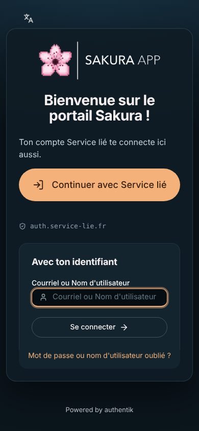

# skra-auth-nds

Thème **Nohriancons** (« Sakura ») pour les pages de connexion d'**authentik**, d'après les maquettes *Authentik connexion service lié*.

| Identification | Mot de passe | Mobile |
| --- | --- | --- |
|  |  |  |

Tout le thème tient dans un seul fichier : [`nohriancons-authentik.css`](nohriancons-authentik.css).
Il a été vérifié sur **authentik 2026.8.7** (captures ci-dessus prises sur une vraie instance).

## Installation

1. **Admin authentik > Système > Brands**, ouvre ta brand.
2. Colle le contenu de `nohriancons-authentik.css` dans **Custom CSS**.
3. Dans la même brand : **Logo** = `assets/logo-sakura.png` (à déposer dans les médias authentik), **Titre** = `Sakura App`.
4. Recharge la page de connexion.

authentik injecte ce CSS dans la page et dans chaque web component (shadow DOM). Pas besoin de monter de fichier `custom.css` dans l'image.

## Configuration des flows (requise pour la mise en page)

La disposition en deux colonnes dépend de la configuration, pas seulement du CSS :

| Où | Réglage |
| --- | --- |
| Source OAuth/OIDC vers l'autre instance | Nom : `Service lié` (ou le vrai nom). **Cocher « Promoted »** : c'est ce qui en fait le gros bouton abricot à gauche. |
| Identification stage du flow de connexion | **Password stage : vide** (le mot de passe est demandé à l'écran suivant). **Sources** : ajouter la source. **Recovery flow** : renseigné, pour afficher « mot de passe oublié ». |
| Flow de connexion | **Titre** : `Bienvenue sur le portail Sakura !`. **Background** : l'image fournie (tons froids de préférence). |

Sans source, l'étape d'identification reste en une seule colonne (cadre de 480 px), avec le même style.

> Les blueprints par défaut d'authentik peuvent réappliquer certains champs de `default-authentication-flow` (titre, champs utilisateur). Si tes réglages sautent après une mise à jour, duplique le flow et lie la copie à la brand.

## Personnaliser les textes

Les textes ajoutés par le thème sont des variables en tête du fichier (section 1) :

```css
--nds-source-label: "Continuer avec Service lié";              /* libellé du bouton de la source */
--nds-source-intro: "Ton compte Service lié te connecte ici aussi.";
--nds-source-domain: "auth.service-lie.fr";                    /* `none` pour masquer */
--nds-form-heading: "Avec ton identifiant";
```

Le libellé du bouton de la source est remplacé par CSS parce qu'authentik ne traduit pas encore « Continue with … » en français.

## Police Avenir Next

Les fichiers .otf ne sont pas dans ce dépôt (licence à vérifier pour un usage web). Pour les activer : dépose-les dans un dossier servi par authentik (ex. `/media/public/fonts/`) et décommente le bloc `@font-face` du fichier. Sans eux, le thème retombe sur `Avenir`, `Nunito Sans`, `Segoe UI` puis la police système.

## Écarts connus avec la maquette

Ces points viennent de textes natifs d'authentik, que le CSS ne peut pas changer proprement :

- Le bouton du formulaire affiche « Se connecter » (maquette : « Continuer ») et celui du mot de passe « Continuer » (maquette : « Entrer »).
- L'écran mot de passe reprend le titre du flow (maquette : « Content de te revoir ! »).
- « Pas vous ? » au lieu de « Pas toi ? », et les messages d'erreur restent ceux d'authentik (ex. « Mot de passe invalide »).
- Le placeholder du champ reprend son libellé (maquette : « ex. malik »).

## Tester en local

`dev/` lance une instance authentik 2026.8.7 jetable, configurée comme les maquettes :

```bash
docker compose -f dev/docker-compose.yml up -d
./dev/setup.sh          # source mise en avant, mot de passe séparé, logo, CSS
./dev/apply-css.sh      # à relancer après chaque modification du CSS
node dev/screenshots.js # captures dans dev/captures/ (Playwright)
```

Connexion de test : `akadmin` / `akadmin-dev`. Ces identifiants sont réservés au test local.

Si le titre reste « Welcome to authentik! », les blueprints par défaut finissaient de s'appliquer : relance `./dev/setup.sh`.
